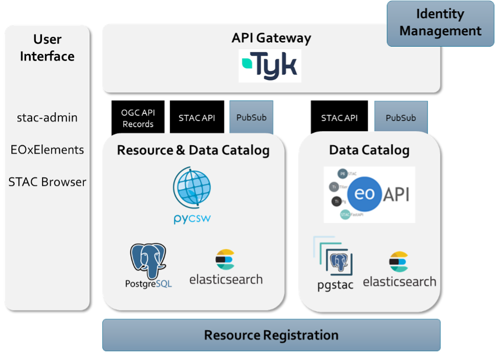
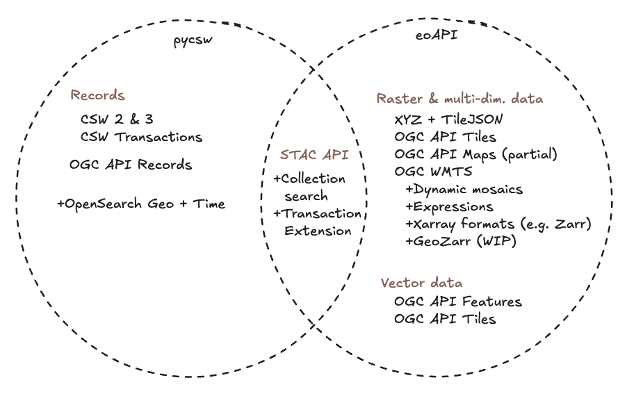

# Architecture

Resource Discovery provides a catalogue that maintains metadata for the resources held within a platform, and also supports platform federation by maintaining records to resources in other platforms.

As described in the [System Architecture document](https://eoepca.readthedocs.io/projects/architecture/) the Resource Discovery Building Block includes the following components:

* **Discovery Interfaces** 
  Extensible set of APIs to support search and discovery. Resource Discovery should present search and browse interfaces. For interoperability these interfaces should be based on open standards: Spatio Temporal Asset Catalog (STAC) and OGC API - Records

* **Metadata Backends** 
  Extensible set of backends in which to persist and query the metadata. The building block establishes separation between its service-layer, and its data storage layer – to facilitate the integration of alternative database technologies, such as PostGIS, ElasticSearch, etc.

* **Resource Handlers** 
  Extensible set of resource types to be handled. The types of resource maintained should be extensible, but should initially include Datasets, Datacubes, Virtual Datacubes, Replicable Workflows, Reproducible Job Details, Jupyter Notebooks, Executable Services, Platform Services, Web Applications, Machine Learning Training Data, Machine Learning Models, Collections, Source Repository, Documentation.

* **Resource Discovery UI** 
  Web-enabled UI providing administrative access to the capabilities of the Resource Discovery BB.

The components design of the Resource Discovery Building Block is shown in the following component figure.

The software pycsw is deployed as Resource Catalogue for all kinds of resources providing OGC API - Records, STAC API (as well as OGC CSW, OpenSearch Geo/Time) and connection to the external automation & notification building block supporting the publish-subscribe (PubSub) mechanism.

The Resource Catalogue is focusing on collection metadata as well as resource types, such as workflows, algorithms, job results, services, web applications, Jupyter notebooks, and documentation.

eoAPI is used as Data Catalogue in addition to pycsw providing STAC API and connection to the external automation & notification building block supporting the PubSub mechanism.

Both components are deployed by default with PostgreSQL as a backend. In the roadmap of EOEPCA, support for Elasticsearch as a backend will be implemented. In this setup, collection metadata from the eoAPI-based data catalogue are registered into pycsw (e.g., using the PubSub mechanism) so that the resource catalogue provide a high-level overview of all resources. Operators of the platform may choose to implement one or both of the catalogue components, depending on their requirements (see [Choosing between pycsw and eoAPI](#choosing-between-pycsw-and-eoapi)).

The web-based administration interface is [STAC Manager](resource-admin-ui/index.md), used to create and edit STAC collections and items in the Data Catalogue.

The STAC API of the Data Catalogue uses [STAC Auth Proxy](https://github.com/developmentseed/stac-auth-proxy) to decide who may read and write each collection, based on logins from the Identity Management building block. See [Access Control](data-catalogue/auth.md).

Further relations exist to the Resource Registration building block, which acts as a transactional client to both catalogue services. In addition, the GitOps-based deployment with Helm Charts and ArgoCD/FluxCD ensures the integration of the proposed components into the Workspace building block.

## Choosing between pycsw and eoAPI

This building block can be deployed with pycsw, with eoAPI, or with both. This section is meant to help integrators decide which combination fits their platform.

### Shared and distinct features

The diagram shows which features pycsw and eoAPI have in common and which each offers on its own:

* **Shared (centre):** Both provide a STAC API, including collection search and the Transaction extension for creating, updating and deleting collections and items.
* **pycsw only (left):** Records catalogue interfaces: OGC CSW 2 and 3 (including CSW Transactions), OGC API - Records, and OpenSearch with the Geo and Time extensions. These make pycsw the choice for catalogues of non-STAC resources such as workflows, services, notebooks and documentation, and for clients that rely on CSW or OpenSearch.
* **eoAPI only (right):** Visualisation and access services on top of the catalogued data.
    * Raster and multi-dimensional data: XYZ tiles with TileJSON, OGC API - Tiles, OGC API - Maps (partial) and OGC WMTS, with dynamic mosaics, band expressions, Xarray formats such as Zarr, and GeoZarr (in progress).
    * Vector data: OGC API - Features and OGC API - Tiles.

### Deployment options

The table below compares the deployment options. ✅ means supported, ⚠️ means supported with limitations, and ❌ means not supported.

| | **1. eoAPI only** | **2. pycsw only** | **3. pycsw (or other) STAC API + eoAPI services, no PgSTAC** | **4. pycsw and eoAPI** | **5. eoAPI with STAC GeoParquet, no database** |
|---|:---:|:---:|:---:|:---:|:---:|
| **Status** | Available | Available | Not yet in eoapi-k8s | Available | Research |
| OGC API - Records | ❌ | ✅ | ✅ if pycsw | ✅ | ❌ |
| OGC CSW 2 & 3, OpenSearch Geo/Time | ❌ | ✅ | ✅ if pycsw | ✅ | ❌ |
| Non-STAC resource types (workflows, services, notebooks, …) | ❌ | ✅ | ✅ if pycsw | ✅ | ❌ |
| STAC API (incl. collection search) | ✅ | ✅ | ✅ | ✅ (two STAC APIs) | ✅ |
| STAC Transaction extension | ✅ | ✅ | ✅ | ✅ | ❌ (read-only) |
| Raster tiles and maps from STAC items (TiTiler) | ✅ | ❌ (WIP: titiler-pycsw) | ✅ | ✅ | ✅ |
| Dynamic mosaics from STAC searches | ✅ | ❌ (WIP: titiler-pycsw) | ❌ (WIP: titiler-pycsw) | ✅ | ❌ |
| Vector features and tiles (TiPg) | ✅ | ❌ | ❌ | ✅ | ❌ |
| Single endpoint for discovering all resources | ⚠️ STAC only | ✅ | ✅ if pycsw | ⚠️ needs sync or duplication | ⚠️ STAC only |
| Databases to operate | PostgreSQL (PgSTAC) | PostgreSQL | One, chosen by the STAC API | PostgreSQL (pycsw) and PgSTAC | None |

Notes on the options:

1. **eoAPI only.** eoAPI with PgSTAC as the Data Catalogue. This gives the full set of data access and visualisation services, but only for resources that can be described as STAC.
2. **pycsw only.** pycsw as the single catalogue for all resource types, without eoAPI or the data access services. Suited to platforms that need a metadata catalogue but no visualisation or access services.
3. **STAC API from pycsw or other software, without PgSTAC.** TiTiler and the other eoAPI services connect to an external STAC API. Services that query PgSTAC directly, such as dynamic mosaics, and the TiPg vector services are not available. This option is not yet supported in [eoapi-k8s](https://github.com/developmentseed/eoapi-k8s) but being considered. https://github.com/developmentseed/eoapi-k8s/discussions/231
4. **pycsw and eoAPI together.** Both catalogues run side by side, each with its own STAC API. pycsw gives an overview of all platform resources, and eoAPI holds the detailed data catalogue. Collection metadata from eoAPI can be registered in pycsw, for example through the PubSub mechanism. There are two ways to handle STAC data:
    * Duplicate all STAC collections and items in both catalogues.
    * Keep collections in pycsw and point them at the items in eoAPI. The links then only go one way, from the pycsw collection to the eoAPI items. How well clients such as STAC Browser handle this is still to be tested.
5. **eoAPI without a database, using STAC GeoParquet.** A read-only STAC API based on [stac-fastapi-geoparquet](https://github.com/stac-utils/stac-fastapi-geoparquet). This is a research topic and not yet part of the building block.

As a rule of thumb:

* Choose **eoAPI only** if your platform needs to serve and visualise EO data and all resources can be described in STAC.
* Choose **pycsw only** if you need a catalogue for many kinds of resources, or standards such as CSW or OGC API - Records, but no data visualisation or access services.
* Choose **pycsw and eoAPI** if you need both, and plan how collection metadata is kept in sync between the two catalogues.

The options were worked out in [EOEPCA/data-access#181](https://github.com/EOEPCA/data-access/issues/181#issuecomment-3252361875).
